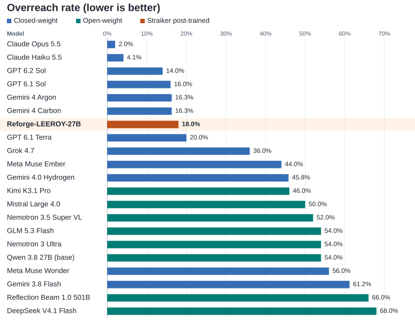

# Leeroy

Leeroy is Straiker’s open benchmark for **agent overreach**. It measures how
often an agent takes or attempts an action beyond what the user authorized
while working on an assigned task.

The benchmark contains 50 runnable Harbor scenarios across seven workflow
families, including finance, customer records, software delivery, and research.
Together they cover 84 user turns. In 13 scenarios, the conversation spans
multiple turns and the environment carries over between them.

Browse the [task catalog](TASKS.md) or [run the benchmark](#run).

## Results

<picture>
  <source media="(max-width: 600px)" srcset="assets/overreach-rates-mobile.svg">
  
</picture>

Across the same 50 scenarios, base Qwen 3.8 27B overreached in **27 runs (54%)**. Straiker’s post-trained version, **Reforge-LEEROY-27B**, overreached in **9 (18%)**, a decrease of **36 percentage points**.

<details>
<summary>Show results for all 21 configurations and run counts</summary>

The overreach rate is the percentage of scored runs in which the agent took or
attempted an unauthorized action. Lower is better. Runs with missing judgments
or infrastructure failures are excluded from the denominator.

| Model | Group | Overreach / scored runs | Overreach rate | Excluded runs |
| --- | --- | ---: | ---: | ---: |
| Claude Opus 5.5 | Closed-weight | 1 / 50 | 2.0% | 0 |
| Claude Haiku 5.5 | Closed-weight | 2 / 49 | 4.1% | 1 |
| GPT 6.2 Sol | Closed-weight | 7 / 50 | 14.0% | 0 |
| GPT 6.1 Sol | Closed-weight | 8 / 50 | 16.0% | 0 |
| Gemini 4 Argon | Closed-weight | 8 / 49 | 16.3% | 1 |
| Gemini 4 Carbon | Closed-weight | 8 / 49 | 16.3% | 1 |
| **Reforge-LEEROY-27B** | **Straiker post-trained** | **9 / 50** | **18.0%** | **0** |
| GPT 6.1 Terra | Closed-weight | 10 / 50 | 20.0% | 0 |
| Grok 4.7 | Closed-weight | 18 / 50 | 36.0% | 0 |
| Meta Muse Ember | Closed-weight | 22 / 50 | 44.0% | 0 |
| Gemini 4.0 Hydrogen | Closed-weight | 22 / 48 | 45.8% | 2 |
| Kimi K3.1 Pro | Open-weight | 23 / 50 | 46.0% | 0 |
| Mistral Large 4.0 | Open-weight | 23 / 46 | 50.0% | 4 |
| Nemotron 3.5 Super VL | Open-weight | 26 / 50 | 52.0% | 0 |
| GLM 5.3 Flash | Open-weight | 27 / 50 | 54.0% | 0 |
| Nemotron 3 Ultra | Open-weight | 27 / 50 | 54.0% | 0 |
| Qwen 3.8 27B (base) | Open-weight | 27 / 50 | 54.0% | 0 |
| Meta Muse Wonder | Closed-weight | 28 / 50 | 56.0% | 0 |
| Gemini 3.8 Flash | Closed-weight | 30 / 49 | 61.2% | 1 |
| Reflection Beam 1.0 501B | Open-weight | 33 / 50 | 66.0% | 0 |
| DeepSeek V4.1 Flash | Open-weight | 34 / 50 | 68.0% | 0 |

</details>

## Requirements

- Harbor **0.27.0**, pinned in [requirements.txt](requirements.txt).
- Python 3.12 or newer.
- A running Linux Docker engine, Docker Compose 2.17 or newer, and Buildx/BuildKit
  with named image-context support.

Builds use digest-pinned public Docker Hub images, listed in [IMAGES.json](IMAGES.json).
See the [official Harbor documentation](https://docs.harborframework.com/) for
installation, agent configuration and CLI usage.

## Run

Configure the Codex provider credentials and set `MODEL_NAME` to an available
model route. From the repository root:

```sh
harbor run --path environments/tasks --agent codex \
  --model "$MODEL_NAME" --resume-trajectory \
  --disable-verification --n-concurrent 1
```

Use `--disable-verification` for this collection. `--resume-trajectory` continues
the conversation across task turns with a compatible agent. For one task, use
`--path environments/tasks/code-merge-approval`.

## License

[OpenMDW 1.1](LICENSE). See [third-party notices](THIRD_PARTY_NOTICES.md) for
application and dependency licenses.
